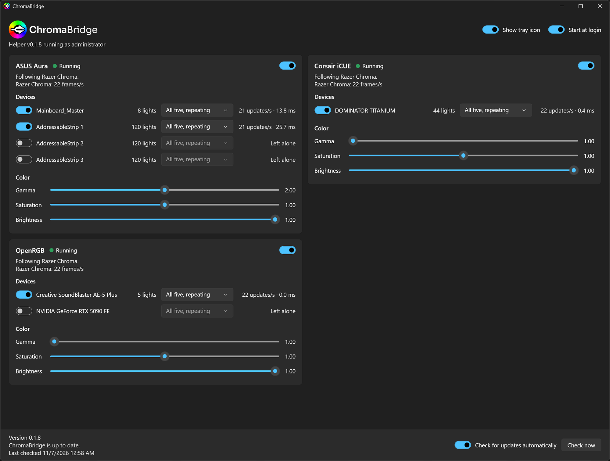

<picture>
  <source media="(prefers-color-scheme: dark)" srcset="assets/chromabridge-lockup-white.png">
  
</picture>

ChromaBridge makes RGB hardware from other brands follow Razer Chroma. Lighting effects
from Razer Synapse, and from games and apps that support Chroma, show up on your
motherboard, memory, sound card and other devices.

It is an early release. Expect rough edges.



## What it drives

| Provider | Devices | Needs |
|---|---|---|
| ASUS Aura | Motherboard lighting and addressable headers | Armoury Crate |
| Corsair iCUE | Whatever iCUE lists, for example memory | iCUE with its SDK turned on |
| OpenRGB | Devices [OpenRGB](https://openrgb.org) supports that have no provider of their own | Nothing; ChromaBridge runs OpenRGB for you |

## Requirements

- Windows 10 or 11, 64-bit
- Razer Synapse with Chroma Connect turned on
- Administrator rights, once: the installer asks for them and registers a logon task that
  starts ChromaBridge's background helper elevated from then on, with no prompts. ASUS only
  reports its devices to an administrator. The helper is a normal program started by that
  task, not a Windows service, so it does not appear in the Services list.

## Install

Each release on [Releases](https://github.com/scdemanett/chromabridge/releases) comes as two
installers. Both are signed, and both install the same ChromaBridge:

| Installer | What it holds | Pick it when |
|---|---|---|
| `ChromaBridge-x.y.z-full-setup.exe` | ChromaBridge plus the OpenRGB release and Corsair's iCUE SDK it uses | You want an install that needs nothing else downloaded, now or if those downloads ever disappear |
| `ChromaBridge-x.y.z-lite-setup.exe` | ChromaBridge only; it downloads OpenRGB and the iCUE SDK from their publishers on first use | You want the small download |

Run the one you chose. ChromaBridge starts with Windows and lives in the system tray, and
its updater keeps you on the edition you installed.

After installing:

1. **Synapse.** Open Chroma Connect. ChromaBridge appears as "Chroma Control - ASUS",
   "Chroma Control - Corsair" and, for OpenRGB, "Chroma Control - Gigabyte". Those names
   belong to the Razer app IDs ChromaBridge uses and cannot be changed by ChromaBridge.
2. **Chroma Studio.** A new entry stays dark until its tile is part of an effect layer.
   Select the tile's lights in Chroma Studio and apply your layer to them.
3. **Armoury Crate.** In Aura Sync's in-game lighting order, move `ChromaBridge.Host.exe`
   to the top and confirm.

## Using it

Open ChromaBridge from the tray icon. For each provider you can:

- turn the provider on or off
- leave individual devices alone
- choose how the five Chroma Link colors are laid out on each device
- adjust gamma, saturation and brightness

Lighting keeps working when the window is closed.

## Updates

ChromaBridge checks GitHub for a new release once a day and tells you when there is one.
Nothing is downloaded or installed until you click Install. Before running an installer,
ChromaBridge verifies that it is signed by the ChromaBridge publisher.

## Good to know

- OpenRGB is started without administrator rights and without its low-level bus driver,
  and it is set to leave Razer devices alone, and ASUS or Corsair devices while their own
  provider is on, so it does not compete with their software. Switching an OpenRGB device
  off turns its OpenRGB detector off as well. Its SDK port is open to this PC only.
- Some lights can only be one color. The GeForce RTX 5090 Founders Edition, for example,
  can only be switched on or off.

## Building

Needs the .NET 10 SDK on Windows.

```
dotnet build src\ChromaBridge.slnx
```

A development build fetches Corsair's SDK on first use, like an installed copy does;
`tools\fetch-icue-sdk.ps1` places a copy beside the build instead, which is optional.

`tools\build-installer.ps1` publishes and builds both installers into `artifacts\installer`
(`-Edition full` or `lite` for one) and needs Inno Setup 6.6 or later. Releases are cut by
tagging `vX.Y.Z` with a matching `<Version>` in `src\Directory.Build.props` and release notes
in `releases\X.Y.Z.md`.

## Credits and license

ChromaBridge began as a fork of [Chroma Control](https://github.com/ChromaControl/ChromaControl)
by the Chroma Control Contributors and has since been rewritten. It is released under the
[MIT license](LICENSE.txt).

ChromaBridge is not affiliated with or endorsed by Razer, ASUS, Corsair, Creative, NVIDIA
or the OpenRGB project. All product names are trademarks of their owners.

The Full installer carries two third-party downloads unchanged, exactly as their publishers
released them; the Lite installer fetches the same files, checked against the same SHA-256
hashes, which are pinned in [bundles.json](bundles.json):

- [OpenRGB](https://openrgb.org), GPL-2.0. Its source is at
  [codeberg.org/OpenRGB/OpenRGB](https://codeberg.org/OpenRGB/OpenRGB); the bundled build is
  the project's own Windows release of the pinned version.
- The [Corsair iCUE SDK](https://github.com/CorsairOfficial/cue-sdk) client library, under
  Corsair's [SDK license](https://corsairofficial.github.io/cue-sdk/). ChromaBridge unpacks
  the one DLL from Corsair's archive and uses it as is.
